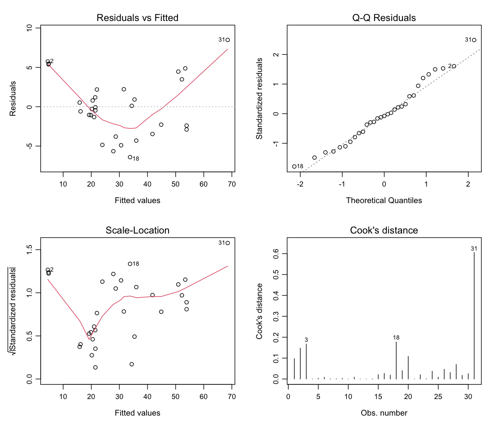

# STAT2004 — Tutorial Practice

A minimal web app for practising the STAT2004 tutorial and applied-class questions.
Filter by topic and difficulty, read the question, reveal the answer when ready.

## Using it

Open `index.html` in a browser. No build step, no server, no dependencies — the question
bank is loaded with plain `<script>` tags so `file://` works.

- **Topic chips** filter by subject area (OR within topics).
- **Difficulty chips** filter by Easy / Medium / Hard (OR within difficulties).
- **Source chips** restrict to the weekly tutorials or to the assignments.
- The filter groups combine with AND, e.g. *Hard* + *ANOVA* shows hard ANOVA questions.
- **Clear all filters** resets to the full bank in tutorial order. It does *not* touch your
  progress marks.
- **Hint** (or the <kbd>H</kbd> key) shows a nudge towards the method plus links to the
  relevant lecture decks, without giving the answer away.
- **Reveal answer** (or the <kbd>R</kbd> key) shows the worked solution; answers stay
  revealed when you navigate away and back.
- <kbd>←</kbd> / <kbd>→</kbd> move between questions.
- The **sun/moon button** in the top right switches between light and dark. By default it
  follows your system setting; once you click it, your choice is remembered (in
  `localStorage`) and the system setting is ignored.
- All mathematics is typeset with real LaTeX via KaTeX, which is bundled locally in
  `vendor/katex/` — so the app still works offline and straight from `file://`.

## Tracking your progress

Every question has three buttons in the top right of its card, and each question carries at
most one mark at a time:

| Button | Meaning | Key |
| ------ | ------- | --- |
| ⚑ Flag | you cannot do it yet | <kbd>F</kbd> |
| ★ Star | you want to come back to it | <kbd>S</kbd> |
| ✓ Tick | you are confident with it | <kbd>T</kbd> |

Clicking the active button clears the mark, so the three behave like a single triage: *stuck →
revisit → confident*. They are mutually exclusive by design, so "how many are left?" always
has one answer.

The **Progress** group at the top of the sidebar shows a live count for each mark and filters
the list to it — handy for a focused revision session on just your flagged questions. The
counts combine with the topic and difficulty filters in the usual way. **Reset progress**
clears every mark; it asks for confirmation first, and it only appears once you have some.

Marks are stored in `localStorage` under `stat2004-status`, so they survive a reload and are
never sent anywhere.

## Contents

All 72 questions, each tagged with topics and a difficulty:

| Source | Material | Questions |
| ------ | -------- | --------- |
| Tutorials | Weeks 2–7 (applied classes) | 5, 5, 5, 4, 4, 3 |
| Tutorials | Weeks 8–13 (tutorials) | 2, 4, 6, 4, 4, 4 |
| Assignments | Assignments 1–4 | 5, 5, 6, 6 |

The applied classes and the tutorials are the same weekly practice material, so they share a
single *Tutorials* source in the app; only the assignments are a separate source. Total: 50
tutorial questions and 22 assignment questions.

Questions labelled *(STAT2904)* and *(bonus)* were the extension parts of the assignments and
are included for extra practice. Assignment 5 of each set is not needed for a STAT2004 student.

Week 13 has no official solution sheet, so its worked answers were computed directly
(verified in R). Week 9 Exercise 1 (the t-method coverage simulation) likewise has no
official solution and is answered from first principles.

## Exam-oriented framing

Because the exam is closed-book with no computer access, no question asks you to run code.
Where the original tutorial asked you to fit a model, run a simulation or draw a plot, the
question now **supplies the R code and the relevant output** — coefficients, sums of squares,
$p$-values, diagnostic tables, power tables, density values — and asks you to interpret it,
which is what an exam can actually test. The worked answers then carry out the hand
arithmetic that is examinable: computing standard errors from a given Hessian, forming a
Wald interval, or verifying a test statistic from summary statistics.

A consequence worth flagging: several of these outputs were recomputed from scratch rather
than copied from the solution sheets, and in two places that changed the given answer.

- **Week 9 Exercise 1** — the coverage study was rerun. The t-interval is more robust than
the original framing suggested: coverage is ≈ 0.90 once $\mu \gtrsim 1$, falling to 0.84 only
at $\mu = 0.2$, where about 5% of samples are degenerate with $s = 0$.
- **Week 6 Exercise 4(a)** — the Bonferroni critical value uses $t_{45}$, not $t_{44}$, since
$n - p = 50 - 5 = 45$: it is 3.520 rather than 3.526. The conclusion is unchanged.
- **Week 10 Exercise 2(h)** — the $\chi^{2}$ threshold was recomputed correctly, giving
$\sum (X_i - \bar{X})^2 \ge 0.607$, i.e. $s \ge 0.189$.
- **Assignment 1 Question 3** — the official code writes the method of moments estimator as
$2\frac{n}{n-1}s^2 / (\frac{n}{n-1}s^2 - \bar{x}^2)$, but the derivation calls for
$\frac{n-1}{n}s^2$ in both places. The correct values are $\hat\alpha = 4.5317$,
$\hat\lambda = 36.08$ rather than $4.5203$ and $35.97$. The MLE is unaffected.

Assignment 2 has no solution sheet, so its answers were worked out from scratch; the
Delivery.csv regression, the Lomax standard errors and the delta-method interval were all
computed in R and are quoted from that output.

### Never let one part give away another

No part may supply the numbers that answer a different part. Two adjustments follow from that
rule, and they are worth keeping in mind when editing:

- **Week 12 Exercise 2.** Parts (c)–(f) are a hand sum-of-squares decomposition, so (g) no
longer prints the R ANOVA table — that gave away the whole of (f). Part (g) now asks only the
conceptual question (why `lm` fits this model, and what the printed degrees of freedom would
be), and the R output appears in the *answer* as confirmation.
- **Power tables (Weeks 9 and 10).** The tabulated power curves omit the values that earlier
parts ask for. Week 9 Exercise 3(d) omits $p = 0.5$ and $p = 0.1$ (the level and power from
parts (b) and (c)); Week 10 Exercise 4(e) omits $\lambda = 7.3$ (the level) and does not
straddle $\lambda = 9.0$; Week 10 Exercise 6(c) omits the $n = 5$ column, which is part (b).

## Files

```
index.html            page shell + script tags
css/style.css         all styling (light & dark, responsive)
js/theme.js           light/dark toggle, run early to avoid a flash
js/lectures.js        catalogue of lecture decks, for hint links
js/progress.js        flag / star / tick state, persisted in localStorage
js/app.js             filtering, rendering, reveal logic, topic labels
js/questions/weekNN.js  the question bank, one file per week
vendor/katex/         KaTeX (JS, CSS, fonts) for LaTeX rendering
img/                  diagnostic plots shown in the questions
```

## Hints and lecture notes

Every question has a **Hint** button. A hint has two parts:

1. **A nudge** — one or two sentences pointing at the technique (the score function, the
   quadratic inequality, which panel of a diagnostic plot to read), deliberately stopping
   short of the answer.
2. **Links to the lecture decks** — one or more PDFs from `lectures/`, opening in a new tab.

The decks are catalogued in `js/lectures.js` under short ids (`l01`, `w7l12`, `w10l3`, …) so a
question only needs `hint: { text: "...", refs: ["l03", "l02"] }`.

### Why hints link to a whole deck, not a page

The lecture PDFs are image-only — scanned handwritten notes with no text layer, so there is
no way to search them or verify that a given page covers a given topic. Hints therefore point
at the deck, identified from its title, date and content: *"Lecture 9 (Week 5) — Outliers,
leverage and collinearity"*. Since no deck is longer than 12 pages, scrolling to the right
place is quick, and this cannot go wrong the way a bad page anchor would.

If you ever want page anchors, the reliable way in is to add a text layer or transcribe the
decks — OCR of the handwriting was too unreliable to trust.

Note that the applied classes and tutorials follow the *previous* week's lectures, so a Week 6
question generally points at Week 5 lecture decks.

## Maths

Maths is written as LaTeX in the data files and rendered by KaTeX:

- `$...$` for inline maths — `$\hat{p}_L$`, `$p_0 \in (0,1)$`
- `<div class="display">$$...$$</div>` for centred display maths (fractions, sums with
  limits, matrices, `aligned` derivations)

`js/app.js` runs `renderMathInElement` on the card after every render, skipping `<pre>` and
`<code>` so that R code such as `fish$count` is never mistaken for maths. Inside HTML
attributes and text, write `&amp;` for a LaTeX alignment ampersand, and make sure a literal
`<` is followed by a space (as in `$x < 0$`) so the browser does not treat it as a tag.

## Figures

Four questions show actual plots, because "assess the assumptions from these diagnostics" is
a plot-reading question, not a numerical one. They live in `img/`:

```html
<figure>
  
  <figcaption>Diagnostic plots for <code>lm(Volume ~ Girth + Height)</code>.</figcaption>
</figure>
```

`figure` is in the block-tag list in `js/app.js`, so it is emitted as a sibling of the
paragraphs rather than being wrapped in a `<p>`; never open an inline tag such as `<strong>`
before a figure and close it afterwards.

Where the plots came from:

- **`kyphosis-binned.png`, `wells-binned-*.png`, `sat-cooks.png`, `sat-expend-ratio.png`** —
  extracted from the original PDFs with `pdfimages`, so they are exactly the plots the
  questions refer to.
- **`trees-diag-*.png`** — regenerated with R (`plot(model, which = 1:4)`), because the
  original sheets showed only the code that produces them. Each is the standard four-panel
  display: residuals vs fitted, normal Q-Q, scale-location and Cook's distance. All have a
  white background so they read correctly in dark mode.

## Theming

The palette is a set of CSS custom properties on `:root`, with a dark override on
`:root[data-theme="dark"]`. `js/theme.js` is loaded in `<head>` (before the body renders)
and sets that attribute immediately, so there is no flash of the wrong theme. Adding a new
colour means adding one variable to both blocks.

## Adding or editing questions

Each `js/questions/weekNN.js` file pushes objects onto `window.QBANK`:

```js
(window.QBANK = window.QBANK || []).push({
  id: "w03q1",            // unique
  week: 3,
  label: "Question 1",
  title: "Maximum likelihood for the geometric distribution",
  difficulty: "Easy",     // "Easy" | "Medium" | "Hard"
  topics: ["mle"],        // ids from the TOPICS list in js/app.js
  hint: {                 // optional: a nudge plus lecture deck ids
    text: "Write the likelihood as $p^{n}(1-p)^{S-n}$ ...",
    refs: ["l03", "l04"]
  },
  stem: `Setup text, may contain HTML.`,
  parts:     [{ l: "a", t: `Question part.` }],
  answer:    [{ l: "a", t: `Solution for part a.` }]
});
```

Content is inserted as HTML, so `<em>`, `<table>`, `<pre><code>` and lists all work, and
maths is written as LaTeX (see above). A part with `l: ""` renders without a letter marker.

Topic labels live in the `TOPICS` array in `js/app.js`; adding a new id there makes it
appear as a filter chip automatically, with a live count.
